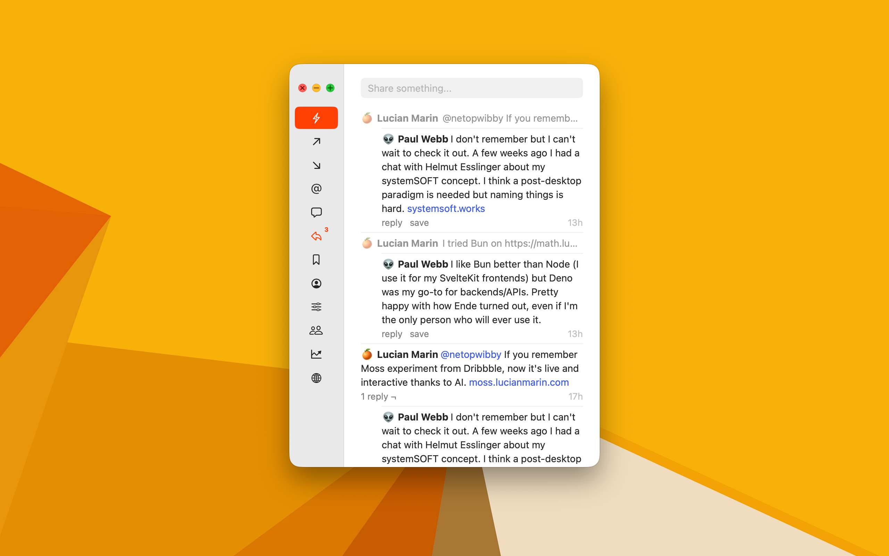

# Macreply



Native macOS client for [Subreply](https://subreply.com) (`subreply.com/api`), built with SwiftUI and Swift Package Manager. It follows the same core design principles as the Subreply web application: a distraction-free, text-first interface driven by a **native macOS sidebar** that switches between **native feeds**.

---

## 1. Design Principles

1. **Native Sidebar + Native Feeds**:
   - Uses a macOS `NavigationSplitView` sidebar to navigate directly between feeds, user profiles, conversations, and account options.
   - All feeds render natively in reverse-chronological order without webviews, ads, or visual clutter.
2. **Text-First & Distraction-Free**:
   - No popularity counters (likes, upvotes, follower counts) or infinite algorithmic noise.
   - Single-paragraph entries capped at **640 ASCII characters** (plus emojis). Pressing `Return` submits the entry directly rather than inserting line breaks.
   - Maximum of one `@mention`, one `#hashtag` (or `#id` reply reference), and one `http(s)://` link per post.
3. **Adaptive Minimalist Palette**:
   - Respects macOS system light and dark appearance.
   - **Accent**: `#2EB8B8` for active sidebar indicators, submit buttons, links, mentions, hashtags, and follow actions.
   - **Alert**: `#FF4500` for unread notification highlights and validation errors.
   - **Surface**: Subtle `whitesmoke` (`#F0F0F0` Light / `#181818` Dark) inputs and 1pt row dividers, with `redsmoke` (`#FFF0F0` Light / `#281818` Dark) warning tint when input exceeds 640 characters.
4. **Rich Inline Content Parsing**:
   - `@username` opens the mentioned member's native profile feed.
   - `#123` (numeric hashref) navigates directly to reply thread `#123`.
   - `#hashtag` (alphanumeric) opens the **Discover** feed filtered by `#hashtag`.
   - `http(s)://...` opens in the default macOS browser and displays a clean shortened host/path label (stripping `http(s)://` and `www.`, truncating addresses over 21 characters with `...`).

---

## 2. Sidebar Navigation & Feeds

The sidebar mirrors `templates/sidebar.html` from the Subreply web app and polls `/api/notifications` to display unread counts in alert orange-red (`#FF4500`).

### Authenticated Sidebar Items
| Item | Endpoint | Description |
| :--- | :--- | :--- |
| **Feed** | `GET /api/feed` | Top-level composer (`Share something...`) + stream of posts from followed users and self. |
| **Following** | `GET /api/following` | Directory of members the current user follows, with inline `follow` / `unfollow` toggle. |
| **Followers** | `GET /api/followers` | Directory of members following the current user. Clears unread follower notifications. |
| **Mentions** | `GET /api/mentions` | Stream of posts mentioning `@username`. Clears unread mention notifications. |
| **Messages** | `GET /api/messages` | Latest direct message per conversation partner. Clicking opens the 1-on-1 message thread (`GET /api/{username}/message`). |
| **Replies** | `GET /api/replies` | Stream of direct replies to the current user's posts. Clears unread reply notifications. |
| **Saved** | `GET /api/saved` | Stream of bookmarked posts. |
| **Profile** | `GET /api/{username}` | Current user's profile header, bio, metadata, social links, and post stream. |
| **Options** | `PATCH /api/profile`, `/api/details` | Segmented native forms for **Profile**, **Details** (social handles & phone), and **Account** (API server URL & logout). |

### Unauthenticated Sidebar Items
| Item | Endpoint | Description |
| :--- | :--- | :--- |
| **About** | Local view | Overview of Subreply's philosophy, features, and privacy principles. |
| **Login** | `POST /api/login` | Authenticate with username/email and password to receive a Bearer token. |
| **Register** | `POST /api/register` | Create a new Subreply account with username, email, password, name, emoji, birthday, and location. |

### Public Discovery Items (Always Visible)
| Item | Endpoint | Description |
| :--- | :--- | :--- |
| **People** | `GET /api/people?q=` | Searchable member directory ordered by recent activity (`seen_at`). |
| **Trending** | `GET /api/trending` | Active top-level threads ordered by reply count, showing nested replies. |
| **Discover** | `GET /api/discover?q=` | Searchable global post stream (defaults to the latest post from each member). |

---

## 3. Feed Layouts & Interactions

### Stream View (`Feed`, `Mentions`, `Saved`, `Discover`, `Member`)
- **Reply Entries (`entry.parent != nil`)**:
  - Renders the parent post as a dimmed single-line inline preview (`opacity: 0.5`) above the reply.
  - Consecutive entries sharing the same parent collapse duplicate parent previews.
  - The reply itself is indented by `30pt`.
- **Thread Entries (`entry.parent == nil`)**:
  - Renders the root post at full width.
  - Displays up to 5 recent replies (`entry.kids`) in chronological order indented by `30pt`.

### Thread / Reply Detail View (`GET /api/reply/{id}`)
- Displays the full `ancestors` chain in chronological order, followed by the target `entry`.
- Shows an inline reply composer (`Reply to @username`), or a contextual placeholder if the current user authored the entry or already replied to it.
- Lists all direct `kids` below, along with their nested `kids` indented by `30pt`.

### Entry Actions Bar
- **Reply link**: Displays `reply` (or `1 reply` / `N replies`), appending `¬` for root threads (`parent == nil`).
- **Save / Unsave**: Calls `POST /api/save/{id}` or `POST /api/unsave/{id}` for other members' posts.
- **Edit**: Opens the inline/sheet editor (`PATCH /api/edit/{id}`) for own posts that have no replies yet.
- **Delete**: Inline two-step confirmation (`delete` -> `undo` / `yes`) calling `POST /api/delete/{id}` when permitted.
- **Timestamp**: Relative time (`5m`, `2h`, `3d`) aligned to the trailing edge.

### Direct Messages (`GET /api/messages` & `GET /api/{username}/message`)
- **Inbox (`Messages`)**: Shows the latest message from each sender with `message` and `read`/`unread` status.
- **Conversation (`/{username}/message`)**:
  - Composer at the top (`Message @username`). Enforces Subreply's chat request rule ("Wait for the recipient to respond" if a first message was sent and not yet answered).
  - Incoming messages from the other user are indented by `30pt`.
  - Own sent messages display `unsend` (`POST /api/unsend/{id}` with `undo / yes` confirmation).
  - Includes a `Clear out` action (`POST /api/{username}/clearout` with confirmation) to delete the conversation history.

---

## 4. API Specification

- **Base URL**: `https://subreply.com/api` (configurable in Options -> Account for local development against `http://localhost:8000/api`).
- **Authentication**: `Authorization: Bearer <token>` header. Token and user profile persist across launches in `UserDefaults` / Keychain.
- **Pagination & Refresh**: `GET` endpoints accept `?p=<page>` (16 items per page for posts/messages, 24 for people/following/followers) and display a `Load more` row when a full page is returned. All feeds support native pull-to-refresh (trackpad overscroll and `.refreshable`).
- **Request Format**: `POST` and `PATCH` requests send `Content-Type: application/json` payloads and parse either the updated resource or `{"errors": {"field": "message"}}`.

---

## 5. Architecture & Project Structure

```text
macreply/
├── Makefile
├── Package.swift
├── README.md
├── Sources/
│   └── Macreply/
│       ├── MacreplyApp.swift          # App entry point, window & command menus
│       ├── Models/
│       │   └── Models.swift           # User, Entry, Chat, Notifications, API responses
│       ├── Networking/
│       │   └── APIClient.swift        # Async/await URLSession client for subreply.com/api
│       ├── State/
│       │   └── AppState.swift         # Navigation stack, auth session, notifications polling
│       ├── Utilities/
│       │   └── ContentParser.swift    # Inline parser for @mentions, #hashtags, #refs, links, age
│       └── Views/
│           ├── MainSplitView.swift    # NavigationSplitView sidebar & detail router
│           ├── SidebarView.swift      # Native sidebar with unread badges
│           ├── FeedView.swift         # Stream, Replies, Trending, Discover, Saved, Mentions
│           ├── EntryRowView.swift     # Entry view, inline parent, sublist kids, actions bar
│           ├── ReplyDetailView.swift  # Ancestors, focus entry, reply composer, nested threads
│           ├── MemberView.swift       # Profile header, follow/message actions, member stream
│           ├── PeopleListView.swift   # People, Following, Followers lists with search
│           ├── MessagesView.swift     # Inbox list and 1-on-1 chat conversation view
│           ├── ComposerView.swift     # Single-line/auto-expanding 640-char composer
│           ├── OptionsView.swift      # Profile, Details, and Account settings forms
│           └── AuthViews.swift        # Login, Register, and About views
└── Tests/
    └── MacreplyTests/
        └── MacreplyTests.swift        # Unit tests for models, content parser, and API decoding
```

---

## 6. Building & Running

Build and bundle `Subreply.app`:

```bash
make app
open Subreply.app
```

Or run directly with Swift Package Manager:

```bash
# Build the app
swift build

# Run unit tests
swift test

# Run the macOS app from terminal
swift run Macreply
```
